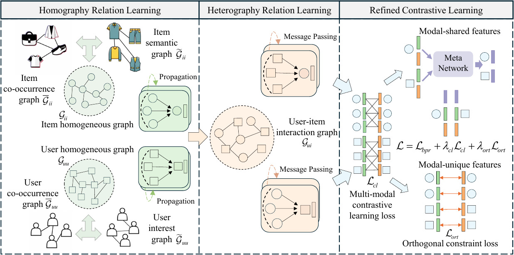

# REARM (MM'25)

**Refining Contrastive Learning and Homography Relations for Multi-Modal Recommendation**

[](https://dl.acm.org/doi/10.1145/3746027.3755779)
[](https://dl.acm.org/doi/10.1145/3767308.3843216)

This repository provides the official PyTorch implementation of **REARM**, introduced at **ACM Multimedia 2025**.

## News

> [!IMPORTANT]
> **🎉 Our reproducibility companion paper has been accepted to the ACM Multimedia 2026 Reproducibility Track!**
>
> Read the paper: **[Reproducibility Companion Paper: Refining Contrastive Learning and Homography Relations for Multi-Modal Recommendation](https://dl.acm.org/doi/10.1145/3767308.3843216)**.

[Papers](#papers) · [Overview](#overview) · [Environment Setup](#environment-setup) · [Datasets](#datasets) · [Run REARM](#run-rearm) · [Repository Structure](#repository-structure) · [Citation](#citation)

## Papers

### Original paper — ACM MM 2025

**[Refining Contrastive Learning and Homography Relations for Multi-Modal Recommendation](https://dl.acm.org/doi/10.1145/3746027.3755779)**  
Shouxing Ma, Yawen Zeng, Shiqing Wu, and Guandong Xu.  
*Proceedings of the 33rd ACM International Conference on Multimedia*, 2025, pp. 6316–6324.

### Reproducibility companion paper — ACM MM 2026

**[Reproducibility Companion Paper: Refining Contrastive Learning and Homography Relations for Multi-Modal Recommendation](https://dl.acm.org/doi/10.1145/3767308.3843216)**  
Huanwen Wang, Xiangqian Chen, Yawen Zeng, Shouxing Ma, Guandong Xu, Mohammad Dindoost, and Itthisak Phueaksri.  
*Proceedings of the 34th ACM International Conference on Multimedia*, 2026, pp. 17096–17099.  
**Reproducibility Track.**

## Overview

REARM is a multi-modal recommendation framework that refines contrastive learning and models homogeneous graph relationships among users and items. It preserves recommendation-relevant information shared across modalities while retaining valuable information unique to each modality.

The framework combines three complementary components:

- **Refined modal-shared representations.** A meta-network filters noise from modal-shared features to improve multi-modal contrastive learning.
- **Preserved modal-unique information.** Orthogonal constraints help retain distinctive, recommendation-relevant information from each modality.
- **Complementary user and item graphs.** User co-occurrence and interest graphs, together with item co-occurrence and semantic graphs, capture structural and semantic relationships.

In the original paper, REARM outperforms several state-of-the-art recommendation baselines on **Baby**, **Sports**, and **Clothing**.

<p align="center">
  
</p>

## Environment Setup

Clone the repository and create the Conda environment:

```bash
git clone https://github.com/MrShouxingMa/REARM.git
cd REARM

conda env create -f environment_build.yml
conda activate rearm
```

The code has been tested with **Python 3.8**. The supplied environment specifies the following core dependencies:

| Dependency | Version |
| --- | --- |
| Python | 3.8 |
| PyTorch | 1.13.0 |
| PyTorch CUDA runtime (`pytorch-cuda`) | 11.7 |
| NumPy | 1.24.4 |
| SciPy | 1.10.1 |

See [environment_build.yml](./environment_build.yml) for the complete environment specification.

## Datasets

We provide three processed datasets: **Baby**, **Sports**, and **Clothing**. Download them individually from Hugging Face using the links below:

| Dataset | Interactions | Users | Items | Sparsity | Download |
| --- | ---: | ---: | ---: | ---: | --- |
| Baby | 160,792 | 19,445 | 7,050 | 99.88% | [Hugging Face](https://huggingface.co/datasets/MrShouxingMa/Baby/tree/main) |
| Sports | 296,337 | 35,598 | 18,357 | 99.96% | [Hugging Face](https://huggingface.co/datasets/MrShouxingMa/Sports/tree/main) |
| Clothing | 278,677 | 39,387 | 23,033 | 99.97% | [Hugging Face](https://huggingface.co/datasets/MrShouxingMa/Clothing/tree/main) |

All three datasets are also available from [Dropbox](https://www.dropbox.com/scl/fo/ok1bso1v2gral5i3bq39p/h?rlkey=qtph647lid3d16mulv5rwvje6&dl=0).

Place the downloaded dataset files in the corresponding directories:

| Dataset | Directory |
| --- | --- |
| Baby | `data/baby/` |
| Sports | `data/sports/` |
| Clothing | `data/clothing/` |

## Run REARM

Run the following commands from the repository root with the `rearm` environment activated. Each command uses the dataset-specific configuration provided in this repository. The examples use Bash line continuations.

### Baby

```bash
python main.py \
  --dataset='baby' \
  --num_layer=4 \
  --reg_weight=0.0005 \
  --rank=3 \
  --s_drop=0.4 \
  --m_drop=0.6 \
  --u_mm_image_weight=0.2 \
  --i_mm_image_weight=0 \
  --uu_co_weight=0.4 \
  --ii_co_weight=0.2 \
  --user_knn_k=40 \
  --item_knn_k=10 \
  --n_ii_layers=1 \
  --n_uu_layers=1 \
  --cl_tmp=0.6 \
  --cl_loss_weight=5e-6 \
  --diff_loss_weight=5e-5
```

### Sports

```bash
python main.py \
  --dataset='sports' \
  --num_layer=5 \
  --reg_weight=0.05 \
  --rank=7 \
  --s_drop=1 \
  --m_drop=0.2 \
  --u_mm_image_weight=0 \
  --i_mm_image_weight=0.2 \
  --uu_co_weight=0.9 \
  --ii_co_weight=0.2 \
  --user_knn_k=25 \
  --item_knn_k=5 \
  --n_ii_layers=2 \
  --n_uu_layers=2 \
  --cl_tmp=1.5 \
  --cl_loss_weight=1e-3 \
  --diff_loss_weight=5e-4
```

### Clothing

```bash
python main.py \
  --dataset='clothing' \
  --num_layer=4 \
  --reg_weight=0.00001 \
  --rank=3 \
  --s_drop=0.4 \
  --m_drop=0.1 \
  --u_mm_image_weight=0.1 \
  --i_mm_image_weight=0.1 \
  --uu_co_weight=0.7 \
  --ii_co_weight=0.1 \
  --user_knn_k=45 \
  --item_knn_k=10 \
  --n_ii_layers=1 \
  --n_uu_layers=1 \
  --cl_tmp=0.03 \
  --cl_loss_weight=1e-6 \
  --diff_loss_weight=1e-5
```

For argument definitions and configuration details, see [utils/parser.py](./utils/parser.py) and [utils/configurator.py](./utils/configurator.py).

## Repository Structure

| Path | Description |
| --- | --- |
| `data/baby/`, `data/sports/`, `data/clothing/` | Dataset directories. |
| `images/model.jpg` | Overview of the REARM framework. |
| `utils/configurator.py` | Experiment configuration. |
| `utils/data_loader.py` | Data loading utilities. |
| `utils/evaluator.py` | Evaluation procedures. |
| `utils/helper.py` | Helper functions. |
| `utils/logger.py` | Logging utilities. |
| `utils/metrics.py` | Recommendation metrics. |
| `utils/parser.py` | Command-line argument definitions. |
| `main.py` | Entry point for training and evaluation. |
| `model.py` | REARM model implementation. |
| `trainer.py` | Training procedures. |
| `environment_build.yml` | Conda environment specification. |

## Citation

If you find REARM, its implementation, or the provided datasets useful in your research, please consider citing the following papers.

### Original paper

```bibtex
@inproceedings{ma2025refining,
  title     = {Refining Contrastive Learning and Homography Relations for Multi-Modal Recommendation},
  author    = {Ma, Shouxing and Zeng, Yawen and Wu, Shiqing and Xu, Guandong},
  booktitle = {Proceedings of the 33rd ACM International Conference on Multimedia},
  pages     = {6316--6324},
  year      = {2025},
  doi       = {10.1145/3746027.3755779},
  url       = {https://dl.acm.org/doi/10.1145/3746027.3755779}
}
```

### Reproducibility companion paper

```bibtex
@inproceedings{huanwenwang2026reproducibility,
  title     = {Reproducibility Companion Paper: Refining Contrastive Learning and Homography Relations for Multi-Modal Recommendation},
  author    = {Wang, Huanwen and Chen, Xiangqian and Zeng, Yawen and Ma, Shouxing and Xu, Guandong and Dindoost, Mohammad and Phueaksri, Itthisak},
  booktitle = {Proceedings of the 34th ACM International Conference on Multimedia},
  pages     = {17096--17099},
  year      = {2026},
  doi       = {10.1145/3767308.3843216},
  url       = {https://dl.acm.org/doi/10.1145/3767308.3843216}
}
```
